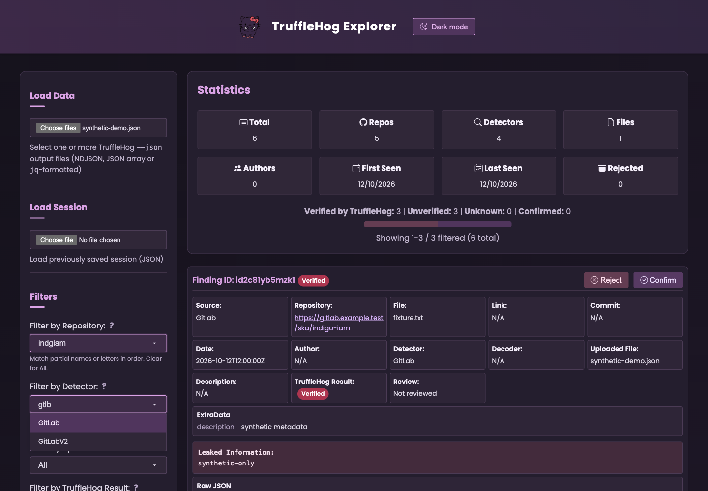

# TruffleHog Explorer

A browser-based viewer for [TruffleHog](https://github.com/trufflesecurity/trufflehog) findings, with fuzzy filters, source-aware metadata, review controls, and light/dark themes.

**[Open the viewer](https://limonkufu.github.io/trufflehog-explorer/)** · **[GitHub repository](https://github.com/limonkufu/trufflehog-explorer)**



This fork builds on [GONZOsint/trufflehog-explorer](https://github.com/GONZOsint/trufflehog-explorer).

## Features

- **Flexible input:** Load multiple TruffleHog output files as NDJSON/JSONL, a JSON array, a single finding, or pretty-printed JSON objects. Non-finding log records are skipped; parsing problems are reported.
- **Repository and detector search:** Type a partial name or abbreviation for case-insensitive fuzzy matching. Suggestions are ranked, and choosing one applies an exact filter.
- **Combined filters:** Narrow findings by uploaded file, TruffleHog result, your review status, date range, a regular expression over `Raw`/`RawV2`, and a regular expression over each finding's link or file path.
- **Light and dark mode:** The header toggle saves your choice. Until you choose a mode, the viewer follows your system theme, including changes while it is open.
- **Source-aware details:** View normalized repository, file, author, and date fields alongside additional source metadata, credential fields, and the original JSON record.
- **Separate review status:** Confirm or reject findings individually or in bulk without overwriting TruffleHog's verification result.
- **JSON exports and session backups:** Export confirmed findings, the current filtered set, or a complete session for later import.
- **Sorting and batches:** Sort by repository, date, or verification status, with 50 findings displayed per batch.

## Use the viewer

Open the [hosted viewer](https://limonkufu.github.io/trufflehog-explorer/), or run it locally:

```bash
git clone https://github.com/limonkufu/trufflehog-explorer.git
cd trufflehog-explorer
open index.html  # macOS; on other systems, open the file in your browser
```

There is no build step or backend. Fonts, icons, and the date picker load from external CDNs.

### Load findings

Use **Load Data** to select one or more output files. The file picker accepts `.json`, `.jsonl`, `.ndjson`, `.txt`, and `.log` files. For example, save TruffleHog's `--json` output and open that file in the viewer.

Loading a new selection replaces the current findings and rebuilds the repository, detector, and uploaded-file choices. The parser reads source metadata rather than assuming every finding came from GitHub.

### Search and filter

Type into **Filter by Repository** or **Filter by Detector** to filter immediately. Matching accepts contiguous text or nonconsecutive letters in order; whitespace-separated terms can match different parts of the name. For example, `gtlb` matches `GitLab`, and `indgiam` matches `indigo-iam`.

- Click a suggestion, or use **↑/↓** and **Enter**, to select an exact repository or detector.
- Use **Escape** or **Tab** to dismiss the suggestions.
- Clear the field or choose **All repositories / All detectors** to remove that filter.
- Use **Clear All Filters** to reset both searches and the other filters.

Repository and detector filters combine with the uploaded-file, result, review, date, raw-result regex, and link regex filters. **Search Link / File (Regex)** is a case-insensitive pattern tested against a finding's link and its file path, so `\.env$` keeps findings in `.env` files and `^docs/` keeps findings under a `docs` directory. The date range includes the whole end day. Repository fuzzy matching uses the URL path so a shared hostname does not create unrelated abbreviation matches.

### Review findings

TruffleHog's result and your review are separate:

| Status | Meaning |
| --- | --- |
| **Verified** | TruffleHog recorded `Verified: true`. |
| **Unverified** | TruffleHog recorded `Verified: false` without a verification error. |
| **Unknown** | Verification errored or the original verification result is unavailable. |
| **Confirmed** | You marked the finding as confirmed in this viewer. |
| **Rejected** | You rejected the finding in this viewer; rejected findings are hidden by default. |

Confirming a finding is a manual review action. The viewer does not contact services to revalidate credentials. Expand a finding to inspect its metadata, leaked information, and original JSON.

**Confirm All Filtered** and **Reject All Filtered** apply to the entire filtered set, including findings outside the currently displayed batch. Use the visibility control to show rejected findings again.

### Export and save

- **Export Confirmed** downloads `confirmed_findings.json` containing all manually confirmed findings.
- **Export Filtered** downloads `filtered_findings.json` containing the current filtered set.
- **Save Session** downloads `session_backup.json` containing all loaded findings and their review flags.
- **Load Session** restores a saved session and rebuilds the filter choices.

Review flags and your theme preference are saved in browser local storage. The loaded scan records themselves are held in memory, so use **Save Session** before leaving if you need a full backup. Browser storage and preferences are separate between the hosted viewer and a local copy.

Selected files are read and processed in your browser; scan data is not uploaded by the viewer. Exported files retain the findings' credential fields.

## GitHub Pages and repository scope

GitHub Pages publishes the static viewer from **`main` → `/` (repository root)** at [limonkufu.github.io/trufflehog-explorer](https://limonkufu.github.io/trufflehog-explorer/).

The `.gitignore` allows only `index.html`, `README.md`, `.gitignore`, `static/icon.png`, and `static/screenshot.png`. Scan files, generated reports, local utility scripts, caches, and other files/folders are ignored. Add any intended new published asset to the allowlist explicitly.
